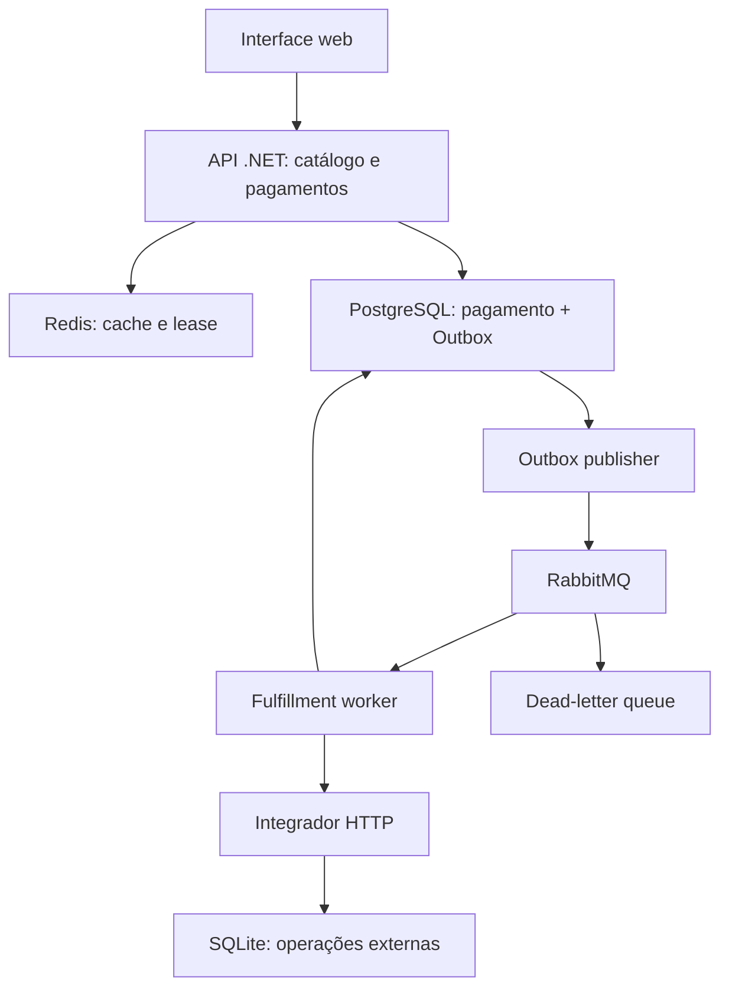

# DigitalGoods Hub

Laboratório de resiliência em **C#/.NET 10** para simular compras de recargas e gift cards, com foco em concorrência, idempotência e recuperação de falhas distribuídas.

O pagamento e o integrador são simulados. Não ocorre cobrança ou recarga real.

**Para clonar, instalar e executar, leia [README_EXECUCAO.md](README_EXECUCAO.md).**

## Problema que o projeto resolve

Uma compra envolve etapas que podem falhar de forma independente: receber o pedido, aprovar o pagamento, publicar uma mensagem, chamar um fornecedor e salvar o resultado. Repetir uma requisição ou receber a mesma mensagem novamente não deve duplicar o efeito da recarga.

O laboratório permite observar esses comportamentos pela interface e pelas APIs, incluindo timeout após sucesso externo e recuperação de processamento interrompido.

## Fluxo principal

1. O cliente seleciona um produto e envia uma chave de idempotência.
2. A API obtém o preço do catálogo e aprova o pagamento simulado.
3. Pagamento e Outbox são persistidos na mesma transação.
4. O publisher publica o trabalho no RabbitMQ e confirma a publicação.
5. O worker consulta o status externo antes de solicitar a recarga.
6. O integrador usa um operation ID estável para reconhecer repetições.
7. O resultado local e a Inbox são persistidos juntos; o consumidor confirma a mensagem.

Falhas transitórias têm até três tentativas, com intervalos de 2s e 5s. Rejeições HTTP 400 encerram a operação sem retry. Após esgotar tentativas sem resultado conhecido, o pagamento passa para `PendingReconciliation`. No modo RabbitMQ, falhas terminais são direcionadas à DLQ.

## Arquitetura

Catálogo, pagamentos, publisher e worker estão na mesma API. O integrador simulado é uma aplicação HTTP separada, com seu próprio banco. Esta versão é um MVP organizado em módulos; os módulos da API ainda não são microsserviços independentes.



## Tecnologias e modos de execução

| Componente | Docker | Local sem Docker |
|---|---|---|
| Backend | ASP.NET Core / .NET 10 | ASP.NET Core / .NET 10 |
| Persistência da API | PostgreSQL + EF Core | SQLite + EF Core |
| Cache do produto | Redis com lease distribuída | MemoryCache com coordenação local |
| Mensageria | RabbitMQ, confirms e ACK manual | Polling durável da Outbox |
| Integrador | Processo HTTP e SQLite separados | Processo HTTP e SQLite separados |
| Interface | HTML/CSS/JavaScript servido pela API | Mesma interface |
| Testes | xUnit e scripts HTTP | xUnit e scripts HTTP |

O modo local não usa Redis nem RabbitMQ. Ele oferece uma alternativa de execução e não comprova as garantias da infraestrutura Docker.

## Funcionalidades

| Funcionalidade | Comportamento |
|---|---|
| Catálogo | Produtos de exemplo, filtros por tipo/fornecedor e preço em centavos |
| Idempotência de pagamento | Índice UNIQUE e hash do corpo; mesma chave com corpo diferente recebe 409 |
| Outbox | Intenção de processamento salva junto com o pagamento |
| Inbox | Resultado local e registro de consumo salvos juntos |
| Coordenação do worker | Lease persistente por pagamento, com expiração de 60s |
| Integrador idempotente | Operation ID único e consulta de status |
| Cache aside | Dupla consulta ao cache e coordenação na reconstrução |
| Diagnósticos | Contadores de pagamento, Outbox, Inbox e consultas do catálogo |

## Cenários disponíveis na interface

| Cenário | Resultado esperado |
|---|---|
| `Success` | Recarga concluída |
| `CrashAfterEffect` | Interrupção simulada após sucesso externo; resultado recuperado por consulta |
| `TimeoutAfterEffect` | Integrador salva a operação antes de atrasar; worker reconcilia |
| `TransientFailure` | Duas respostas 503; sucesso na terceira tentativa |
| `PermanentFailure` | Rejeição HTTP 400; estado Failed |
| `Unavailable` | Tentativas esgotadas; PendingReconciliation |

`CrashAfterEffect` simula a perda do resultado por exceção; não encerra o processo. Há um script separado para testar a queda real e o restart.

## APIs

| Método | Caminho | Finalidade |
|---|---|---|
| GET | `/health` | Disponibilidade do banco da API |
| GET | `/api/products` | Catálogo; aceita filtros `type` e `provider` |
| GET | `/api/products/{id}` | Consulta de produto com cache |
| POST | `/api/payments` | Pagamento simulado; exige `Idempotency-Key` |
| GET | `/api/payments/{id}` | Estado de uma operação |
| GET | `/api/payments` | Últimas 30 operações, com telefone mascarado |
| GET | `/api/diagnostics` | Contadores e modo de execução |
| POST | Integrador: `/provider/recharges` | Operação externa simulada |
| GET | Integrador: `/provider/recharges/{id}` | Consulta de status externo |
| GET | Integrador: `/provider/operations` | Operações externas registradas |

Exemplos de requisições: [DigitalGoodsHub.http](DigitalGoodsHub.http).

## Estrutura

```text
src/DigitalGoodsHub.Api                 API, interface, cache, publisher e worker
src/DigitalGoodsHub.Core                modelos e persistência
src/DigitalGoodsHub.ProviderSimulator   integrador HTTP simulado
tests/DigitalGoodsHub.Tests             testes de concorrência, cache e validação
scripts                                execução, publicação e testes HTTP
.github/workflows/ci.yml                build, testes e smoke com Docker
README.md                              explicação do projeto
README_EXECUCAO.md                      requisitos, instalação e operação
```

## Limites da versão

- Laboratório local, sem autenticação, pagamento real ou reembolso. Os serviços publicados pelo Compose ficam em localhost.
- Não existe garantia global de exactly-once. O efeito externo depende da idempotência e da consulta de status oferecidas pelo integrador.
- Publisher e worker são sequenciais dentro da API; o backoff mantém a mensagem sem ACK, sem filas intermediárias de retry.
- Redis usa lease de 10s sem renovação. Consultas que excedem essa janela exigem uma estratégia mais completa de coordenação.
- Bootstrap por `EnsureCreated`; evolução do esquema exige migrations.
- `Failed` e `PendingReconciliation` exigem tratamento posterior; reprocessamento manual e compensação não estão implementados.
- Health verifica o banco do serviço; não verifica todas as dependências. Tracing distribuído e alertas são evoluções futuras.
- DLQ usa fila clássica em um único nó; alta disponibilidade não está implementada.

## Próximos passos

Separar o worker da API, ampliar os testes de infraestrutura, adicionar autenticação, migrations, tracing, alertas e um fluxo de reconciliação/compensação.
